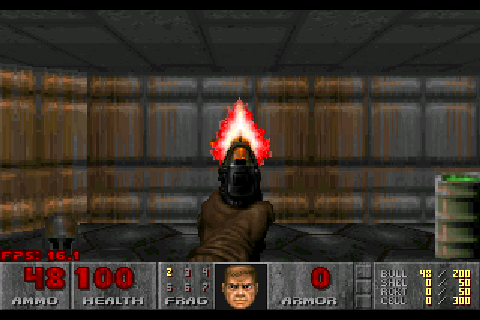

# Doom for the Alientek DM40

A separate firmware for the Alientek DM40 multimeter (GD32F427, 200 MHz,
256 KiB RAM, ILI9488 480x320) that runs shareware Doom. It does not replace
or change [opendm40](https://github.com/wirenboard/opendm40): it is a
different image installed the same way, and the way back is the vendor
updater.



Based on [next-hack's Doom port for the EFR32MG24](https://github.com/next-hack/MG24_Doom_BLE)
(itself based on [doomhack's GBADoom](https://github.com/doomhack/GBADoom)).
That port already keeps the WAD in an external SPI flash that is not
memory-mapped and fits in 256 KiB of RAM; this tree adds a DM40 hardware
layer and the changes below.

Status: runs in the [opendm40 emulator](https://github.com/wirenboard/opendm40/tree/main/emu)
(title, demos, menus, E1M1 played with the touch screen; E1M6, the largest
shareware level, loads). Not run on a device yet.

Known limits:

- no sound, no music;
- no saved games (Load / Save show a message);
- only the Hynitron touch controller (the one on the tested unit) is handled,
  not the Goodix GT1158 opendm40 also supports;
- SPI1 runs at 12.5 MHz without opendm40's boot-time clock check; garbled
  textures on a device would point at the SPI clock (`0x031F` = /16 in
  `sf_init`);
- the frame rate on a device is unknown: the emulator's timing is not
  cycle-exact, and the MG24 port reads its flash at 2 x 40 MHz with DMA;
- a level whose geometry does not fit the 256 KiB level cache stops with
  "Level too big for the flash cache" (E1M6 uses 245 KiB of it).

## What is different from the MG24 port

| | MG24 port | DM40 |
|---|---|---|
| WAD | raw in two interleaved SPI flash chips, DMA | `DOOMMCU.WAD` file on the meter's FAT16 volume (W25Q128, 4096-byte sectors), read through its cluster runs, polled SPI1 at 12.5 MHz |
| flash cache | ~1 MiB of internal flash, erased per 8 KiB page | 384 KiB: sector 6 (WAD-wide data), sectors 7 + 8 (level data), each erased whole |
| flats that do not fit | always fit | LRU of 10 flats in TCM, loaded from the SPI flash on a miss |
| display | SPI panel, DMA line buffers | 16-bit FSMC, 320x200 shown 1.5x (480x300), synchronous blit |
| RAM | 256 KiB contiguous | SRAM 192 KiB (frame buffers, zone; the port's 16-bit pointers need it) + TCM 64 KiB (stack, flat cache, render buffers) |
| input | buttons / shift registers | touch screen zones + side keys (Hynitron controller, I2C2) |
| network, sound | BLE multiplayer, OPL2 music, SFX | none |

The image is built with `-Os` (the renderer `-O2`) and reduced math tables so
that code and data end below sector 6 (0x08040000).

## Flash use

| Address | Sector | Content |
|---|---|---|
| 0x08000000 | 0 | ROM bootloader (vendor), never touched |
| 0x08004000 .. 0x0803FFFF | 1 .. 5 | this image (installed by the vendor FS-loader) |
| 0x08008000 | 2 | 12-byte loader marker; zeroed only to return to the updater |
| 0x08040000 .. 0x0809FFFF | 6 .. 8 | Doom flash cache, rewritten by this firmware |
| 0x080A0000 .. | 9 .. 11 | vendor FS-loader, UID data, calibration, never touched |

[port/hal.c](port/hal.c) `fcache_erase` accepts only the sector numbers 6, 7
and 8; `fcache_program` refuses any address outside 0x08040000..0x0809FFFF;
`marker_zero` writes only the three marker words. The loader's CRC covers
only the image, so it keeps starting after the cache is rewritten.

The cache is rebuilt when the signature at the end of sector 6 does not match
the build and the WAD, and sectors 7 + 8 at every level start.

## Controls

| Where | Action |
|---|---|
| left third of the screen | stick: up = forward, down = back, left / right = turn |
| centre column | top: menu; middle: next weapon; bottom: automap |
| right third | top: use (doors, switches); bottom: fire / menu select |
| side keys | MENU = menu, RUN = fire, AUTO = use, MF = next weapon |
| power key, held 1.5 s | switch off |

## Building

```sh
make                      # build/dm40-doom.elf, build/dm40-doom.bin (arm-none-eabi-gcc)
cc -std=gnu99 -O2 -w -Wno-error=incompatible-pointer-types -o wadutil/mcudoomwadutil wadutil/*.c
cd wadutil && ./mcudoomwadutil /path/to/doom1.wad DOOMMCU.WAD
```

`mcudoomwadutil` must run in the directory that holds `mcudoom_0_4.wad`.
The shareware `doom1.wad` (v1.9, md5 `f0cefca49926d00903cf57551d901abe`) is
in Debian's `doom-wad-shareware` package.

## Running in the emulator

From an opendm40 checkout (its `emu/`):

```sh
emu/run.py fwrs --name doom --app ../dm40-doom/build/dm40-doom.elf \
    --disk-add DOOMMCU.WAD::DOOMMCU.WAD --run-for 30 --shot doom.png
```

`--disk-add` copies the WAD into a private copy of the emulated disk. Taps and
keys: `--key menu@8 --tap 400,250@9.5`, or `monitor sysbus.i2c3.touch Press
X Y` / `Release` lines in a `--script` file. [tools/prof.sh](tools/prof.sh)
samples the PC; [tools/dbglog.py](tools/dbglog.py) decodes the `dbg_log` RAM
ring (the port's `printf` output) from a run that read it with
`sysbus ReadBytes`.

## Installing on a meter

Not done on a device yet. In the emulator, steps 1-2 were run through the
vendor ROM and FS-loader (`emu/run.py chain --zero-marker` with both files
on the disk): the loader installed the packed image and Doom started.

1. From opendm40: `DBG:UPDATE` (or from the stock firmware: its update
   function). The meter restarts into the vendor loader's update screen with
   its own USB disk.
2. Copy `DOOMMCU.WAD` and the packed image to that disk, press update. Pack
   with opendm40's `stock/dm40fw.py pack build/dm40-doom.bin dm40doom.bin
   --pad` (the name must match `dm40*.bin`, and it must be the only such
   file in the root).
3. To go back: hold the power key 3 s in the window after start-up (the
   start screen says so), or let the watchdog fire. Doom zeroes the loader
   marker and resets into the same update screen; copy an opendm40 or stock
   `dm40*.bin` there.

## License

GPL v2 or later (Doom source release, PrBoom, GBADoom, the MG24 port); see
[LICENSE](LICENSE). Marco Paland's printf: MIT. Font8x8: public domain.
