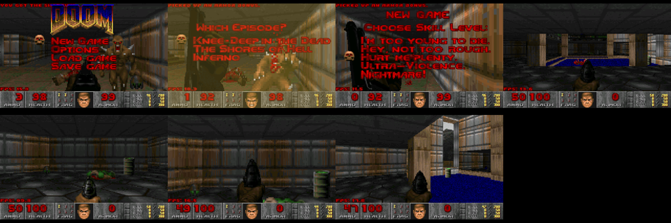
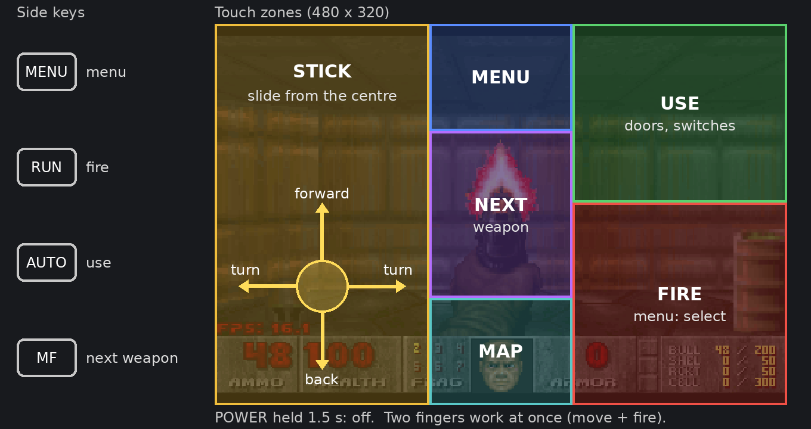
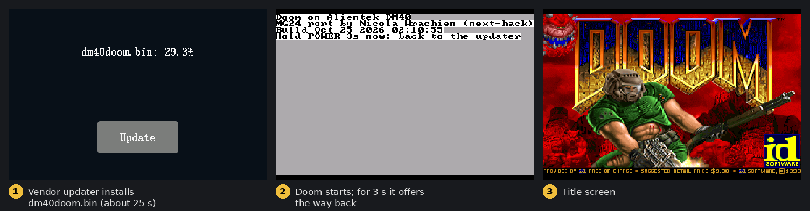
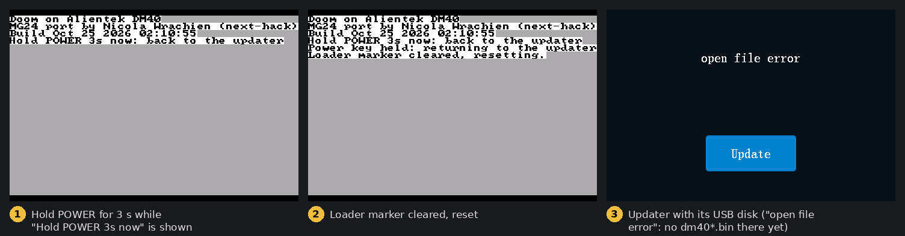
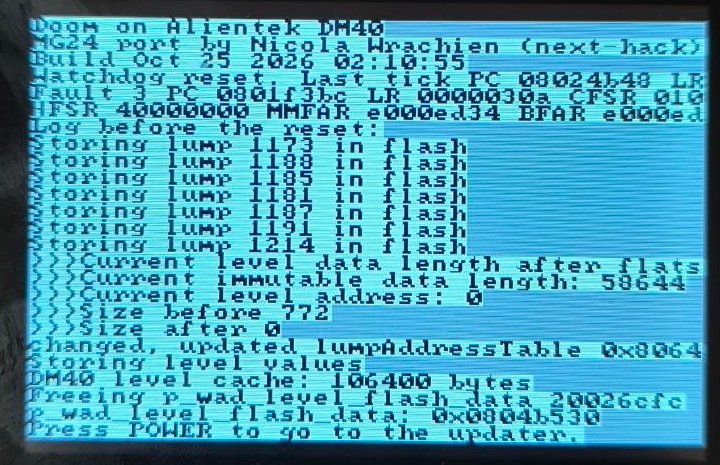

# Doom for the Alientek DM40

Firmware for the Alientek DM40 multimeter (GD32F427, 200 MHz, 256 KiB RAM,
ILI9488 480x320) that runs shareware Doom. It is installed with the vendor
updater, and the way back is the same updater.


Based on [next-hack's Doom port for the EFR32MG24](https://github.com/next-hack/MG24_Doom_BLE)
(itself based on [doomhack's GBADoom](https://github.com/doomhack/GBADoom)).
That port already keeps the WAD in an external SPI flash that is not
memory-mapped and fits in 256 KiB of RAM; this tree adds a DM40 hardware
layer and the changes below.

Status: runs on a DM40A, installed through the vendor FS-loader: title,
menus and E1M1 played with the touch screen, about 20 FPS on the in-game
counter.



Only E1M1 and E1M2 are in the image: the level data the port keeps in
internal flash is baked into the firmware file (below), and the image has room
for about 340 KiB of it.

Known limits:

- two levels, E1M1 and E1M2 ([port/levels.c](port/levels.c)); leaving E1M2
  ends the episode (finale text); no demos (they play E1M5, E1M3, E1M7);
- no sound, no music;
- no saved games (Load / Save show a message);
- only the Hynitron touch controller (the one on the tested unit) is handled,
  not the Goodix GT1158 opendm40 also supports;
- SPI1 runs at 12.5 MHz without opendm40's boot-time clock check; garbled
  textures on a device would point at the SPI clock (`0x031F` = /16 in
  `sf_init`);
- about 20 FPS on E1M1. Wall patches and flats that do not fit a level's
  region are read from the SPI flash while drawing (polled, 12.5 MHz; the
  MG24 port reads its flash at 2 x 40 MHz with DMA), and the frame is sent
  to the panel synchronously. Only the low 512 KiB of the GD32F4 flash are
  zero-wait (to 0x08080000); the end of the E1M2 region lies above that.

## What is different from the MG24 port

| | MG24 port | DM40 |
|---|---|---|
| WAD | raw in two interleaved SPI flash chips, DMA | `DOOMMCU.WAD` file on the meter's FAT16 volume (W25Q128, 4096-byte sectors), read through its cluster runs, polled SPI1 at 12.5 MHz |
| flash cache | ~1 MiB of internal flash, rewritten at each level start | baked into the image: 60 KiB WAD-wide data + one fixed region per level; the firmware never writes it |
| flats that do not fit | always fit | LRU of 10 flats in TCM, loaded from the SPI flash on a miss |
| display | SPI panel, DMA line buffers | 16-bit FSMC, 320x200 shown 1.5x (480x300), synchronous blit; as in the MG24 port, the status bar rows are sent only when it changed |
| RAM | 256 KiB contiguous | SRAM 192 KiB (frame buffers, zone; the port's 16-bit pointers need it) + TCM 64 KiB (stack, flat cache, render buffers) |
| input | buttons / shift registers | touch screen zones + side keys (Hynitron controller, I2C2) |
| network, sound | BLE multiplayer, OPL2 music, SFX | none |

The image is built with `-Os` (the renderer `-O2`) and reduced math tables to
leave room for the cache.

## Flash use

| Address | Sector | Content |
|---|---|---|
| 0x08000000 | 0 | ROM bootloader (vendor), never touched |
| 0x08004000 .. | 1 .. | this image: code (~225 KiB), then the baked cache (to 0x0809C3xx) |
| 0x08008000 | 2 | 12-byte loader marker; zeroed only to return to the updater |
| 0x080A0000 .. | 9 .. 11 | vendor FS-loader, UID data, calibration, never touched |

The MG24 port converts the level data (vertexes, lines, sides, segs, nodes,
blockmap, sectors ...) on every level start and keeps it in internal flash,
which the renderer reads like RAM; on the DM40 there is no RAM for it (E1M2:
~170 KiB). Here that data is produced once, in the emulator, and shipped in
the image:

- `_fcache_start` (after the code): WAD-wide region, 60 KiB;
- then one fixed region per level of [port/levels.c](port/levels.c)
  (E1M1 120 KiB, E1M2 the rest). The level's geometry is mandatory; the rest
  of its region holds flats and wall patches.

[tools/bake.py](tools/bake.py) runs the image in the emulator with a bake key
in RAM (hal.c `fcache_bake_key`); the firmware sets up each level, which
programs the regions onto erased flash, and the emulator saves the flash. On a
meter the key is absent: the same level setup code compares each word with
the flash instead of writing it (w_wad.c `programFlashWord`), and stops with
"baked data differs" on a difference. Level restarts and other skills give the
same words (the skill-dependent thing list stays in RAM; a buffer whose
length is not a multiple of 4 is padded with zeros, not with the zone bytes
after it). In the emulator this was run with SRAM and TCM filled with a
pattern before start, through E1M1 -> intermission -> E1M2 -> finale. The image must be
baked again after every build: the cache holds absolute addresses, and its
signature includes the build time.

The only runtime flash write left is `marker_zero` (three words at
0x08008000), on the way back to the updater.

## Controls



The stick is centred at (90, 220) with a dead zone of 22 px; the zones are in
[port/input.c](port/input.c), the picture is drawn by
[tools/controls-image.py](tools/controls-image.py). In menus the stick moves
the cursor, FIRE selects, MENU goes back.

## Building

```sh
make                      # build/dm40-doom.elf, build/dm40-doom.bin (arm-none-eabi-gcc 14.2)
tools/make-wad.sh         # build/DOOMMCU.WAD
tools/bake.py ../opendm40 build/DOOMMCU.WAD   # build/dm40-doom-baked.bin, build/dm40doom.bin
```

[tools/make-wad.sh](tools/make-wad.sh) builds the converter
(`wadutil/`, next-hack's MCUDoomWadUtil) and converts the shareware
`doom1.wad` v1.9 (md5 `f0cefca49926d00903cf57551d901abe`), downloaded from
Debian's `doom-wad-shareware` package or given as an argument; the result
always has the same md5, which the script checks (the converter here
allocates zeroed memory, so padding bytes no longer differ between runs).
`tools/bake.py` needs an opendm40 checkout (its emulator with a meter's
flash dumps, and `stock/dm40fw.py`) and takes about a minute; it also packs
the update file.

CI ([.github/workflows/build.yml](.github/workflows/build.yml)) builds the
firmware and checks the WAD conversion; it cannot bake (no flash dumps
there). Releases are made with `tools/release.sh TAG ../opendm40`: a clean
worktree of the tag, `make-wad.sh`, `bake.py`, then a GitHub release with
`dm40doom.bin`, `dm40-doom.elf` and `SHA256SUMS`.

## Running in the emulator

From an opendm40 checkout (its `emu/`):

```sh
emu/run.py fwrs --name doom --app ../dm40-doom/build/dm40doom.bin \
    --disk-add DOOMMCU.WAD::DOOMMCU.WAD --run-for 30 --shot doom.png
```

The baked image is needed: the plain `build/dm40-doom.elf` stops with "No
flash cache for this build and WAD".

`--disk-add` copies the WAD into a private copy of the emulated disk. Taps and
keys: `--key menu@8 --tap 400,250@9.5`, or `monitor sysbus.i2c3.touch Press
X Y` / `Release` lines in a `--script` file. [tools/prof.sh](tools/prof.sh)
samples the PC; [tools/dbglog.py](tools/dbglog.py) decodes the `dbg_log` RAM
ring (the port's `printf` output) from a run that read it with
`sysbus ReadBytes`.

## Installing on a meter

From a [release](https://github.com/evgeny-boger/dm40-doom/releases):
`dm40doom.bin` (the update file) and `dm40-doom.elf` (for `addr2line`, see
below). `DOOMMCU.WAD` is not attached: make it with `tools/make-wad.sh`
([Building](#building)); each image needs exactly that file.



1. From opendm40: `DBG:UPDATE` (or from the stock firmware: its update
   function). The meter restarts into the vendor loader's update screen with
   its own USB disk.
2. Copy `DOOMMCU.WAD` and `dm40doom.bin` to that disk, press update. The name must match `dm40*.bin`, and it must be
   the only such file in the root.
3. Doom starts; press MENU, then New Game.

### Going back



Switch the meter off (POWER 1.5 s) and on, then hold POWER for 3 s while the
start screen shows "Hold POWER 3s now". Doom zeroes the loader marker and
resets into the update screen; copy an opendm40 or stock `dm40*.bin` there
and press Update. After a watchdog reset the fault screen below comes
first, and POWER goes to the same update screen.

## Faults and hangs

A fault draws a red bar at the bottom of the panel and stops; a hang stops
feeding the watchdog. Either way the watchdog resets the meter about 20 s
later, and instead of going straight to the updater Doom shows what the
last session left in RAM (TCM `.noinit`, kept over the reset): the PC / LR
the last SysTick interrupted, the fault's number, PC, LR, CFSR, HFSR,
MMFAR, BFAR, and the last lines of the `dbg_log` ring (level set-up prints
each step). POWER then goes to the updater.



`arm-none-eabi-addr2line -f -i -e dm40-doom.elf <PC>` names the function,
with the ELF of the installed image (attached to each release; keep your
own for local builds). The photo above was taken from an earlier build,
which cut the register lines at 60 characters.

The emulator does not raise the Cortex-M4 UNALIGNED fault for LDRD / STRD /
LDM / STM on an address that is not word-aligned; the meter does (the MG24
`fastOpeningsCopy` faulted that way on the first frame, now a `memcpy`).

## License

GPL v2 or later (Doom source release, PrBoom, GBADoom, the MG24 port); see
[LICENSE](LICENSE). Marco Paland's printf: MIT. Font8x8: public domain.
